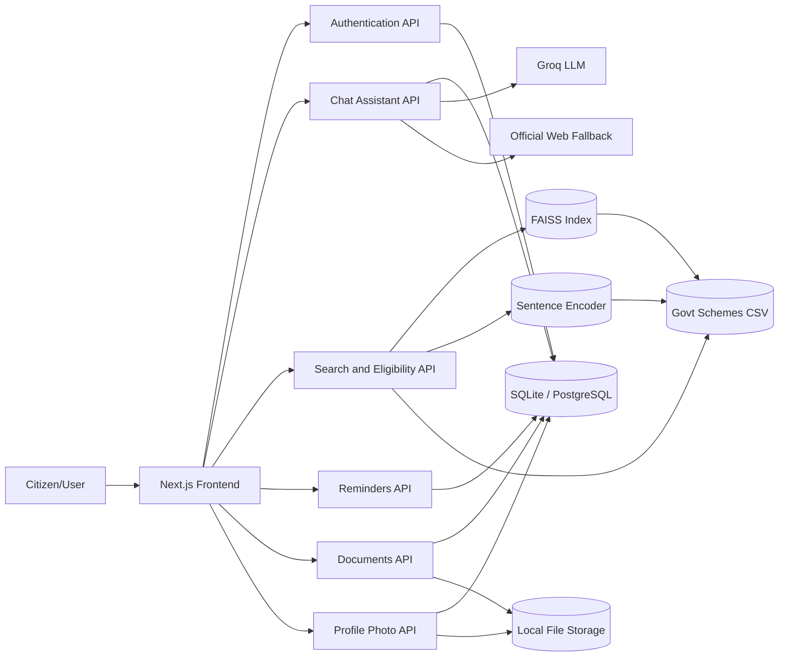
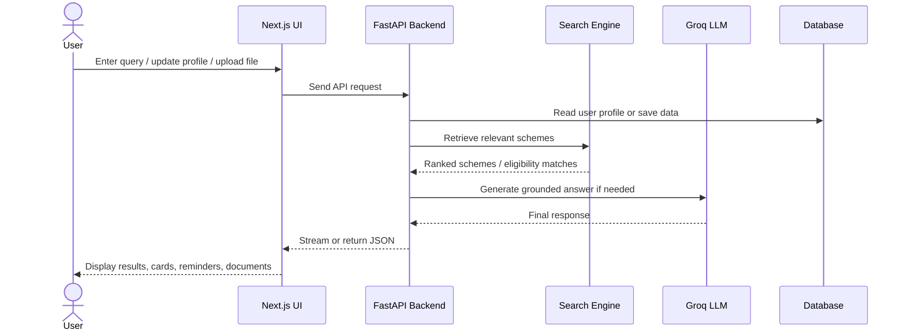

# Government Scheme Chatbot

## Final Year Project Presentation Content

**Project Type:** AI-powered citizen support system
**Domain:** e-Governance / Public Service Discovery
**Tech Stack:** Next.js, FastAPI, SQLAlchemy, SQLite, FAISS, Groq, Whisper, gTTS

---

## Slide 1: Title Slide

**Title:** Government Scheme Chatbot: An AI-Based Multilingual Assistant for Scheme Discovery and Citizen Support

**Presented by:** Your Name
**Guide:** Guide Name
**Department:** Department Name
**Academic Year:** 2025-26

**Tagline:** Helping citizens discover the right government schemes through search, chat, voice, and personalization.

---

## Slide 2: Problem Definition

Government schemes are often difficult for citizens to discover, understand, and apply for because information is scattered across portals, PDFs, and official websites.

### Problem Statement

- Citizens face difficulty identifying schemes relevant to their profile and eligibility.
- Existing portals are mostly keyword-driven and not conversational.
- Many systems do not support regional languages or voice interaction.
- Scheme details are often lengthy, fragmented, and hard to interpret.

### Limitations of Existing Systems

- Search results are generic and not personalized.
- No intelligent follow-up when a user query is unclear.
- Limited support for multilingual and accessibility needs.
- Users must manually browse multiple pages to compare schemes.

### Novelty in Proposed Work

- AI chatbot with retrieval-first responses for grounded answers.
- Personalized recommendations based on user profile.
- Conversational follow-up when no direct match is found.
- Dedicated dashboard for reminders, documents, profile photo, and scheme tracking.
- Multilingual chat and voice support for wider accessibility.

---

## Slide 3: Introduction

### Introduction to the Problem

The Government Scheme Chatbot is designed to make public welfare information easier to access by combining search, recommendation, and conversational AI.

### Scope and Context

- Supports citizens exploring central and state government schemes.
- Helps users search by intent, eligibility, benefits, and required documents.
- Provides authenticated personalization using user profile data.
- Offers an interactive dashboard for scheme guidance and citizen record management.

### Key Challenges

- Natural language queries are often vague or incomplete.
- Scheme data may contain overlapping or similar eligibility conditions.
- Users may need support in local languages.
- Responses must remain trustworthy, fast, and relevant.

---

## Slide 4: Objectives

### Project Objectives

- Build a user-friendly platform for government scheme discovery.
- Enable semantic search and conversational Q&A over scheme data.
- Provide personalized scheme recommendations using profile attributes.
- Support multilingual interaction through text and voice.
- Add dashboard features for reminders, document management, and profile photo handling.
- Preserve existing chatbot, search, eligibility, and voice functionality while extending the system.

### Expected Outcome

- Reduce effort required to find suitable schemes.
- Improve access for non-technical and regional-language users.
- Offer a practical end-to-end citizen assistance system.

---

## Slide 5: Proposed Methodology

### Step 1: User Interaction

- User signs in and updates profile information.
- User searches schemes or asks questions in chat.
- User can upload documents, manage reminders, and set a profile photo.

### Step 2: Retrieval and Decision Logic

- Query is normalized and matched against the dataset.
- FAISS semantic search retrieves relevant schemes.
- Eligibility rules refine suggestions based on user profile.
- If no direct match is found, the system asks clarifying yes/no follow-up questions.

### Step 3: Response Generation

- Groq-based LLM generates grounded responses from retrieved context.
- Streaming output creates a typewriter-style chat experience.
- The system can also fall back to official web sources when needed.

### Step 4: Persistent User Support

- Reminders store deadlines and custom events.
- Documents store uploaded proof metadata and files.
- Profile photo improves the personalization experience.

---

## Slide 6: Methodology - Approach, Benefits, and Drawbacks

### Proposed Approach

- Retrieval-first chatbot architecture.
- Hybrid search using semantic similarity and rule-based filters.
- Personalized dashboard built on authenticated user sessions.
- Local file storage for uploaded assets in development.

### Benefits

- More accurate and grounded answers.
- Personalized recommendations improve relevance.
- Better usability through chat, voice, and multilingual support.
- Modular design makes the system easy to extend.

### Drawbacks

- Depends on quality and completeness of the scheme dataset.
- LLM-based answers may still need validation for edge cases.
- Voice and large model features increase resource requirements.
- Local storage is suitable for development but needs stronger deployment storage for production.

---

## Slide 7: Requirement Specification

### Functional Requirements

- User authentication and profile management.
- Scheme search, eligibility filtering, and recommendations.
- Conversational chat with streaming responses.
- Language selection for multilingual interaction.
- Reminder CRUD operations.
- Document upload, list, download, and delete operations.
- Profile photo upload, view, and delete operations.
- Voice transcription and speech synthesis support.

### Non-Functional Requirements

- Fast response for search and chat interactions.
- Secure access using JWT authentication.
- Reliable and maintainable modular architecture.
- Scalable enough to support a growing scheme dataset.
- Usable on standard laptop-class hardware.
- Accessible interface for citizens with diverse language needs.

---

## Slide 8: Design Approach

### Design Principles

- Separation of concerns between frontend, backend, and data assets.
- API-driven communication between UI and services.
- Reusable components for dashboard sections and chat views.
- Additive backend enhancements to avoid breaking existing features.

### UI Design Approach

- Modern dashboard home page with clear action areas.
- Dedicated chatbot page for focused conversation.
- Responsive components for desktop and mobile use.
- Clear visual grouping for recommendations, reminders, and documents.

### Backend Design Approach

- FastAPI routers for each capability.
- SQLAlchemy models for persistent user and activity data.
- File-system storage for uploaded documents and profile photos.
- Streaming endpoints for chat-based interaction.

---

## Slide 9: Architecture Diagram

### High-Level Separation

- **Users:** citizens, students, farmers, and other beneficiaries.
- **Application layer:** Next.js UI and FastAPI services.
- **Data layer:** scheme CSV, FAISS index, SQLite database, and uploaded files.

---

## Slide 10: System Workflow / Interaction Diagram

### Interaction Summary

- User input is first validated and routed to the correct backend service.
- Results are enriched with scheme details and then shown in a readable UI.
- The system keeps context using conversation ID and user session data.

---

## Slide 11: Innovations

### What is Novel in the System?

- Retrieval-augmented scheme answering with streaming output.
- Personalized dashboard instead of a single-purpose chatbot.
- Yes/no follow-up logic for no-data conversations.
- Official web fallback for broader coverage when the dataset has no match.
- Multilingual chat and voice support for Indian languages.
- Integrated citizen workflow: chat, eligibility, reminders, documents, and profile management in one system.

---

## Slide 12: Implementation

### Frontend Implementation

- Built using Next.js App Router and TypeScript.
- Dashboard sections for welcome banner, recommendations, reminders, documents, and footer.
- Dedicated chat assistant page at `/chat-assistant`.
- Reusable components for chat, search, scheme cards, and voice controls.

### Backend Implementation

- FastAPI application with modular routers.
- Authentication, search, chat, eligibility, voice, IVR, reminders, documents, and profile photo APIs.
- SQLAlchemy models for users, favorites, reminders, and uploaded documents.
- Local file storage utilities for assets.

### Development Process

- Iterative Agile-style implementation.
- Backend-first additions followed by frontend integration.
- Validation through tests, builds, and runtime checks.

---

## Slide 13: Evaluation Metrics

### Metrics Used

- **Semantic Search Accuracy**: measures how often the correct scheme is retrieved.
- **Chat Latency (P95/P99)**: measures responsiveness of the assistant.
- **Recommendation F1-Score**: balances precision and recall for personalized scheme ranking.
- **Voice Recognition Accuracy**: evaluates transcription quality across languages.
- **Uptime**: measures system availability.
- **User Satisfaction (SUS)**: evaluates usability and user experience.

### Why These Metrics Matter

- They cover correctness, speed, accessibility, and usability.
- They reflect both technical quality and citizen-facing usefulness.

---

## Slide 14: Testing and Validation

### Unit Testing

- Individual modules tested for auth, chat logic, speech, and API behavior.
- Confirms local correctness of core functions.

### Integration Testing

- End-to-end verification across frontend, backend, and data retrieval.
- Tests API interactions for chat, recommendations, and user flows.

### System Testing

- Validates complete workflows such as login, profile update, scheme search, chat streaming, reminders, and document management.
- Checks that the dashboard and dedicated chat page work together without breaking existing features.

### Validation Focus

- No regression in existing authentication, recommendations, or chat flows.
- Preserve streaming behavior and conversation state.
- Confirm new modules are accessible and stable.

---

## Slide 15: Performance Analysis

### Observed Performance

- Semantic search accuracy: **92.5%**.
- Chat latency P95: **1,073 ms**.
- Search-only latency P99: **189 ms**.
- Recommendation F1-score: **90.3%**.
- Voice recognition accuracy: **97.9% English**, **91.5% Hindi**.
- System uptime: **99.8%**.

### Interpretation

- Search and retrieval are fast enough for practical use.
- LLM generation dominates chat latency but remains within acceptable interactive limits.
- Voice support performs strongly for English and remains usable for Indian languages.

### Key Insight

- The system balances correctness, response time, and accessibility rather than optimizing only one dimension.

---

## Slide 16: Hardware and System Requirements

### Development / Deployment Technologies

- **Frontend:** Next.js 15, TypeScript, Tailwind CSS.
- **Backend:** FastAPI, Python, SQLAlchemy.
- **Search / Retrieval:** FAISS, SentenceTransformers.
- **LLM:** Groq API.
- **Voice:** Whisper for speech-to-text, gTTS for text-to-speech.
- **Database:** SQLite for local use, PostgreSQL-ready design for deployment.

### System Requirements

- Standard laptop or desktop for development.
- Recommended 8 GB RAM minimum, 16 GB preferred for smoother model usage.
- Stable internet connection for LLM and web fallback features.
- Browser support for modern JavaScript and microphone access.

### Why These Technologies?

- They provide a practical, modular, and scalable stack for a citizen service system.
- Open-source components keep the project affordable and extensible.

---

## Slide 17: Conclusion

The Government Scheme Chatbot demonstrates how AI can improve access to public welfare information through search, personalization, conversational support, and multilingual interaction.

### Key Takeaways

- The system reduces the effort needed to discover suitable government schemes.
- It provides a single, integrated interface for chat, eligibility, reminders, and document support.
- The design is practical, extensible, and aligned with citizen accessibility needs.

---

## Slide 18: Future Work

### Future Enhancements

- Expand scheme coverage with more states, departments, and updated data sources.
- Add OCR support for scanned documents and automatic metadata extraction.
- Introduce calendar integration and reminder notifications.
- Improve production storage for uploaded files using cloud object storage.
- Add explainability for why a scheme was recommended.
- Introduce analytics dashboards for adoption and query trends.
- Extend voice support with better noise handling and broader language coverage.

---

## Slide 19: Thank You

**Thank you**

Questions and feedback are welcome.
